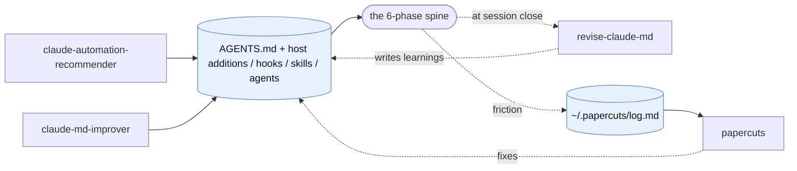

# The flow the skills form

The skills trace one development lifecycle, tied together by one idea: **durable state lives in `docs/`, and the chat is scratch.** Each phase reads the artifacts the previous phase wrote and leaves its own behind, so you can `/clear` any session and resume cold. The kit generalizes [SKILL.state](skill-state-and-the-ledger-pattern.md) from one skill to the whole set, with the document tree as the bounded, reconciled state.

The HTML renders live in [diagrams/](diagrams/). The spine render includes the additions from [mattpocock/skills](mattpocock-skills-eval.md); the meta-loop render predates `writing-for-agents`†.

## The spine

```mermaid
flowchart LR
  subgraph U[1 · Understand]
    sdm[system-design-mentor]
    grill[grill-me]
    t3[third-opinion]
    tq[to-questionnaire†]
    ho[handoff†]
  end
  subgraph D[2 · Design]
    daf[design-a-feature]
    dai[design-an-interface]
    viz[archify · beautiful-mermaid]
    dr["decision-record → docs/adr/"]
    proto[prototype]
    dm["domain-modeling → CONTEXT.md"]
  end
  subgraph P[3 · Plan]
    msp[multi-session-plan]
  end
  subgraph B[4 · Build / Execute]
    rs[run-state]
    co[complexity-optimizer]
    apprun[run*]
    craft[craft]
    tdd[tdd†]
    dbg[diagnosing-bugs]
  end
  subgraph R[5 · Review]
    cr[code-review*]
    sim[simplify*]
    sec[security-review*]
    rst[review-staged]
    rmr[review-mr]
    cen[census]
    cec[cross-engine-check]
    ver[verifier*]
  end
  subgraph S[6 · Ship]
    ship[ship-session]
  end

  U --> D --> P --> B --> R --> S
  R -. re-open .-> B
  S -. next session .-> P
  cen -. reconcile across sessions .-> cen

  classDef doc fill:#e8f0fe,stroke:#4285f4,color:#111;
  class msp,rs,cen,ship,dr,dm doc;
```

`*` marks platform built-ins the kit composes with. `†` marks community skills installed as-is from `upstream-sources.txt` (mattpocock/skills). Dotted edges mark the loops that carry state from one session to the next.

## Phase by phase

**1 · Understand: confirm the problem and your grasp of it.**
`system-design-mentor` teaches the trade-off space. `grill-me` interrogates a plan until you resolve each branch, and `third-opinion` cross-checks it against another model. This phase produces comprehension, which feeds the first doc. `to-questionnaire`† turns a decision someone else holds the facts for into a questionnaire; `handoff`† carries the thread to another harness or directory.

**2 · Design: compare real alternatives.**
`design-a-feature` and `design-an-interface` hold the task stable and vary the interaction or module shape, so you choose from real options instead of the first idea. `archify` and `beautiful-mermaid` render the chosen shape. You make the *decision* in this phase, and `decision-record` writes it as an ADR under `docs/adr/`, so the choice and what would prove it wrong outlive the chat. `prototype` covers the runnable half of design: N variants on one route, or a single-file state-machine demo, for a question you cannot settle on paper. As decisions land, `domain-modeling` keeps the terms consistent and writes the glossary to `CONTEXT.md`.

**3 · Plan: sequence the work.**
`multi-session-plan` turns the chosen design into linked docs under `docs/`: an index, one doc per session, and a deferred-work roadmap. The build reads these back as its first durable state.

**4 · Build / Execute: do the work with flat context.**
`run-state` executes a long homogeneous run (migration, backlog, mechanical refactor) against an external state file, so context stays bounded and you can `/clear` mid-run. `complexity-optimizer` fixes perf hotspots inline. `craft` frames the slices with a Shape note before the first edit (data shape, parse at the boundary, edit or redesign, idempotency, single writer) and a Right note before done (no silenced checker, the empty-return test, CRAP and duplication scores on the changed files). `tdd`† drives each slice red-green at pre-agreed seams. `diagnosing-bugs` runs the loop for a hard bug: build a red feedback loop first, then minimise, hypothesise, instrument, and fix with a regression test. Both read the plan doc; run-state writes its own state file. `/run` (native) launches the real app to confirm a change works at runtime. Of all the Build steps, only `/run` exercises the built thing beyond its tests.

**5 · Review: check safety and standing debt.**
Review works at two altitudes. **Diff-scoped:** `code-review` gates a change on correctness and quality. `/simplify` (native) does the quality-only pass without the gate, and `/security-review` (native) adds the security lens the custom kit lacks. `review-staged` triages staged changes; `review-mr` formats findings as MR comments. `cross-engine-check` verifies a CSS claim across engines, and `verifier` re-checks a single claim cold. **Repo-scoped:** `census` surveys the whole standing codebase and keeps a reconciled ledger under `docs/census/`. You re-take that ledger across sessions, which makes it the one review artifact that persists.

**6 · Ship: verify and close the session.**
`ship-session` verifies the acceptance gates, converts the plan doc from forward-plan to as-built reference, trims the index to match what shipped, and commits. The next session picks up at Plan.

## Native built-ins the kit composes with

Claude Code ships its own dev-flow commands, and the custom skills wrap and sequence them. Four native skills slot into the phases (marked `*` in the spine):

- **`/run`** (Build) launches and drives the real app to confirm a change works at runtime. The custom kit is doc- and test-centric, and `/run` is the one step that exercises the built thing.
- **`/code-review`** (Review) gates a diff on correctness and quality. `review-staged` and `review-mr` wrap the same job with host-specific, stateful handling; `/code-review` is the bare gate.
- **`/simplify`** (Review) runs the quality-only pass: reuse, simplification, efficiency, altitude. It skips bug hunting. Reach for it as the cleanup half of `/code-review` when you want polish without the gate.
- **`/security-review`** (Review) applies a security lens to the pending diff. No custom skill specializes in security, so this one sits next to `code-review` (correctness) and `census` (standing debt) to fill that gap.

One native skill cuts across phases instead of sitting in one:

- **`/goal <condition>`** installs a session-scoped Stop hook that blocks the session from ending until the condition holds, then clears itself. The `docs/` backbone makes state durable, and `/goal` makes an exit gate binding. You can pin any phase's acceptance criterion ("tests green", "reviewed", "verified") so the session cannot stop short of it. The ledger records what you finished; `/goal` keeps the session open until you finish it. Worked example: `/goal /verify` holds the session open until the agent verifies the work, and the `verifier` agent (a cold re-check of a single claim) runs the check the gate waits for.

## The meta-loop: tuning the harness the flow runs in

The spine develops the *product*, and a second, smaller loop develops the agent setup. The shared working policy lives in `AGENTS.md`. `CLAUDE.md` imports it and adds Claude Code instructions.

`revise-claude-md` captures what the *user* taught in a session. The Papercuts rule in `AGENTS.md` captures what the *agent* tripped over: each session appends friction to `~/.papercuts/log.md`, and the hand-typed `papercuts` skill triages that log into fixes to the configuration. See [the papercuts evaluation](papercuts-eval.md).

The three plugin skills carry no `*`:

- **`/claude-code-setup:claude-automation-recommender`** reads a codebase and recommends the hooks, subagents, skills, plugins, and MCP servers it should have. Run it when you first point Claude Code at a project, or when the setup feels thin.
- **`/claude-md-management:claude-md-improver`** audits each `CLAUDE.md` against a quality bar and applies targeted fixes. Use it for config *maintenance*, once the memory has drifted from how the project works.
- **`/claude-md-management:revise-claude-md`** writes what the session taught back into `CLAUDE.md` at session close. It closes the loop and mirrors `ship-session` on the config side: `ship-session` turns the session into as-built product docs, and `revise-claude-md` turns it into a sharper harness for the next run.

One community skill governs the writing itself:

- **`writing-for-agents`**† is the reference for writing the skills and steering files: context pointers, the two loads (context and cognitive), leading words, no-ops, and the user-invoked versus model-invoked trade. Read it before you edit anything in `custom-skills/` or `AGENTS.md`.

Read the diagram as a loop. The configuration shapes each phase, the spine exposes gaps in the configuration, and `revise-claude-md` writes Claude Code lessons back to `CLAUDE.md`.

Move host-neutral lessons from `CLAUDE.md` to `AGENTS.md`. Keep only Claude Code instructions in `CLAUDE.md`.

## The document backbone

You can `/clear` without losing the kit's state because the stateful skills write to files in the repo:

| Skill | Reads | Writes |
|---|---|---|
| `multi-session-plan` | design decision | `docs/<plan>/` index + session docs + roadmap |
| `run-state` | plan doc | run-state file (ledger of units) |
| `census` | whole repo + `docs/adr/` | `docs/census/` reconciled ledger |
| `ship-session` | plan doc | as-built plan doc + commit |
| `decision-record` | design fork | `docs/adr/` ADR |
| `domain-modeling` | conversation | `CONTEXT.md` glossary |

Together these skills form one stateful pipeline: decide → plan → execute → survey → close. Each step reconciles against a file instead of rebuilding from chat history. Three loops let the pipeline repeat across sessions: census reconciles its own ledger, review re-opens a build unit, and ship hands back to plan.

## Decision capture

Before `decision-record`, each phase persisted its state except **Design**. A decision you made at a design fork lived only in the chat, the append-only-history failure the kit exists to avoid. `census` reads `docs/adr/` and assumes ADRs exist, but no skill wrote them. `decision-record` fills that gap. At a fork, `design-a-*` generates the options, `grill-me` pressure-tests them, and `decision-record` writes the winner and the reason to `docs/adr/`. `census` then reads that ADR and treats the choice as by-design. The kit takes the idea from `show-me-blueprint` without adopting the skill; see [the blueprint evaluation](show-me-blueprint-eval.md).
