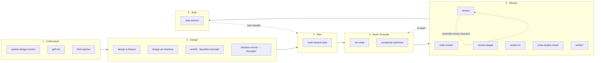

# The flow the skills form

These skills aren't a loose bag of tools — they trace one development lifecycle, and they're wired together by a single idea: **durable state lives in `docs/`, not in the conversation.** Each phase reads the artifacts the previous phase wrote and leaves its own behind, so any session can `/clear` and resume cold. That's [SKILL.state](skill-state-and-the-ledger-pattern.md) generalized past one skill to the whole kit — the document tree is the bounded, reconciled state; the chat is scratch.

## The spine

`*` = platform built-ins the kit composes with, not custom skills. Dotted edges are the loops that make the kit stateful rather than one-shot.

## Phase by phase

**1 · Understand — is this the right problem, and do I actually get it?**
`system-design-mentor` teaches the trade-off space; `grill-me` interrogates a plan until every branch is resolved; `third-opinion` cross-checks against another model. Output is comprehension — not yet a doc, but the input to one.

**2 · Design — what shapes could this take?**
`design-a-feature` / `design-an-interface` hold the task stable and vary the interaction/module shape, so you choose from real alternatives instead of the first idea. `archify` / `beautiful-mermaid` render the chosen shape. This is where a *decision* gets made — and `decision-record` captures it as an ADR under `docs/adr/`, so the choice (and what would prove it wrong) outlives the chat.

**3 · Plan — sequence it.**
`multi-session-plan` turns the chosen design into linked docs under `docs/`: an index, one doc per session, a deferred-work roadmap. This is the first durable state the build will read back.

**4 · Build / Execute — do the work with context held flat.**
`run-state` executes a long homogeneous run (migration, backlog, mechanical refactor) against an external state file, so context stays bounded and the session can be `/clear`'d mid-run. `complexity-optimizer` fixes perf hotspots inline. Both read the plan doc; run-state writes its own state file.

**5 · Review — is it safe, and what standing debt remains?**
Two altitudes. **Diff-scoped:** `code-review` gates a change, `review-staged` triages what's staged, `review-mr` formats findings as MR comments, `cross-engine-check` verifies a CSS claim across engines, `verifier` re-checks a single claim cold. **Repo-scoped:** `census` surveys the whole standing codebase and keeps a reconciled ledger under `docs/census/` — the one review artifact that persists and gets re-taken across sessions.

**6 · Ship — close the session honestly.**
`ship-session` verifies the acceptance gates, converts the plan doc from forward-plan to as-built reference, trims the index to the truth, and commits. It hands the baton back to Plan for the next session.

## The document backbone

The reason the kit survives a `/clear` is that every phase that matters writes to `docs/`:

| Skill | Reads | Writes |
|---|---|---|
| `multi-session-plan` | design decision | `docs/<plan>/` index + session docs + roadmap |
| `run-state` | plan doc | run-state file (ledger of units) |
| `census` | whole repo + `docs/adr/` | `docs/census/` reconciled ledger |
| `ship-session` | plan doc | as-built plan doc + commit |
| `decision-record` | design fork | `docs/adr/` ADR |

Read top to bottom, that's a single stateful pipeline: decide → plan → execute → survey → close, each step reconciled against a file rather than reconstructed from history. The loops — census reconciling itself, review re-opening a build unit, ship handing back to plan — are what make it a *system* instead of a checklist.

## Decision capture — the gap, now closed

Every phase persisted its state except **Design**: a decision made at a design fork lived only in the chat — exactly the append-only-history failure mode the whole kit is built to avoid. `census` even *reads* `docs/adr/`, assuming ADRs exist, but nothing wrote them. `decision-record` closes it: at a fork, `design-a-*` generates the options, `grill-me` pressure-tests them, and `decision-record` writes which one won and why to `docs/adr/` — where census then reads it as by-design. The idea was harvested from `show-me-blueprint` without adopting the skill; see [the blueprint evaluation](show-me-blueprint-eval.md).
